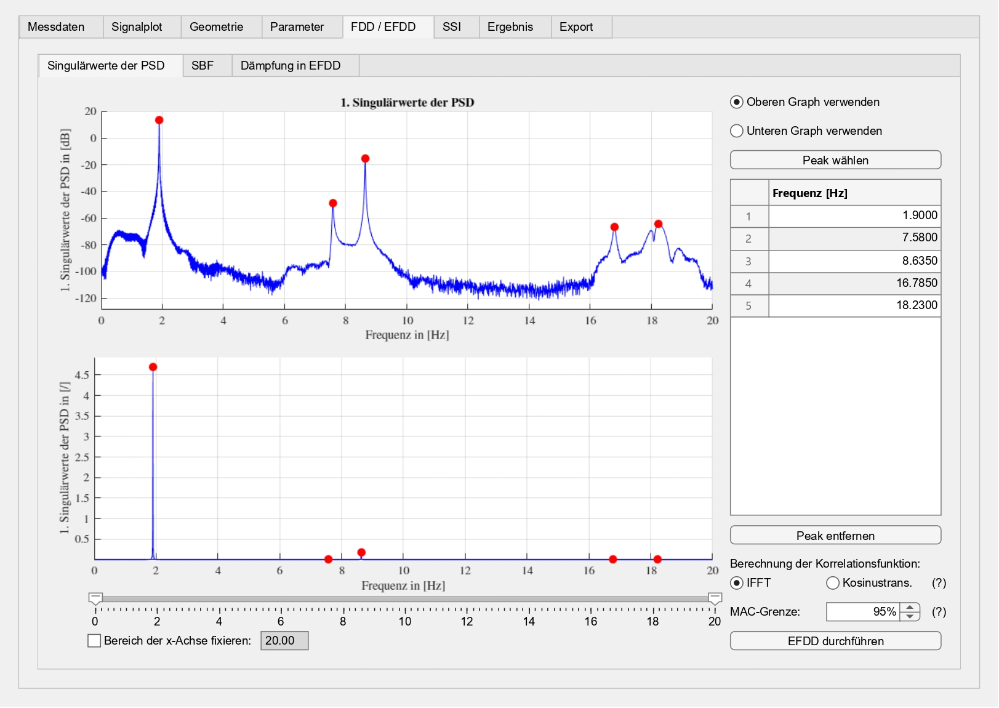
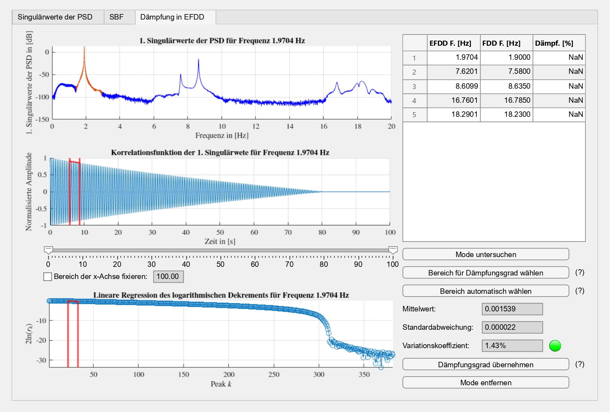
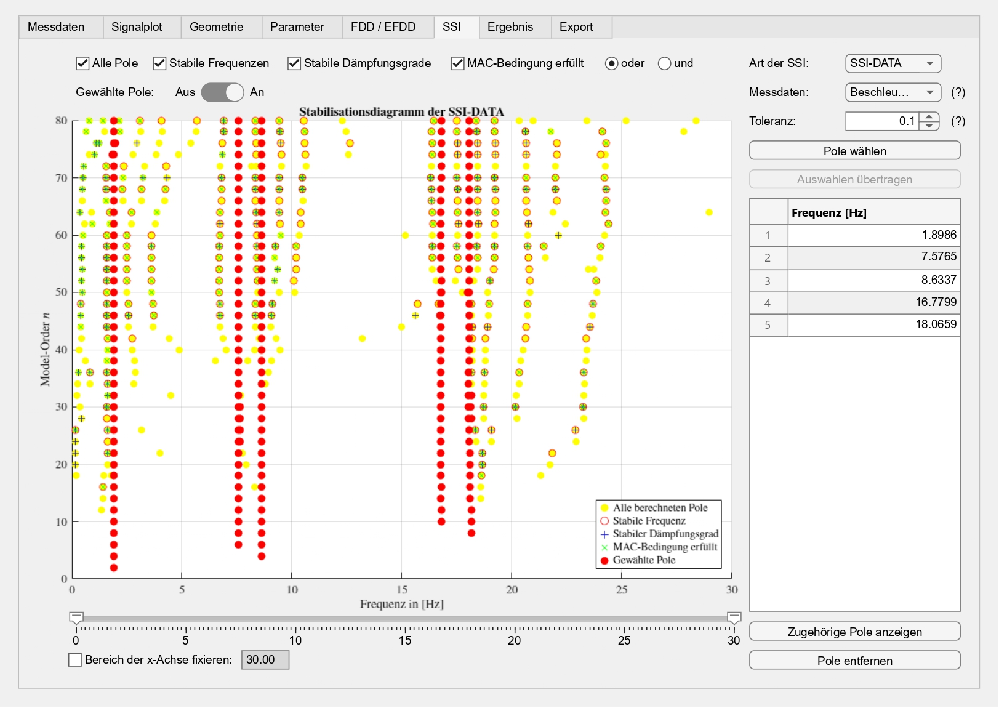
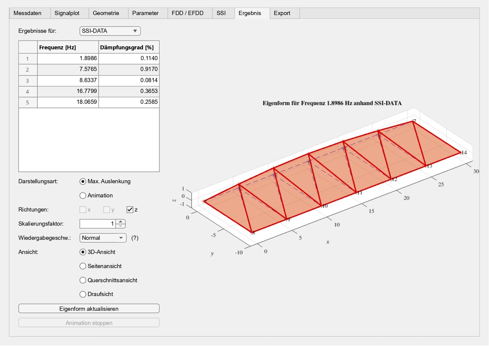
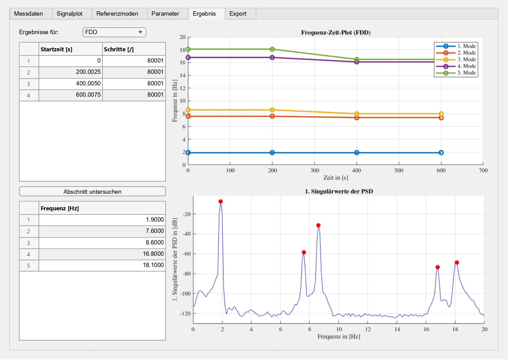

# App_Zustandsueberwachung_anhand_OMA
## Worum geht es? :bulb:
Im Rahmen einer Masterarbeit wurde eine interaktive App in `MATLAB` entwickelt. Die App ermöglicht die Auswertung von Schwingungsmessdaten mittels verschiedener _Operational Modal Analysis_ (**OMA**)-Methoden und unterstützt die Zustandsüberwachung von Strukturen.

Sie umfasst drei Hauptfunktionen: 
1. **Modalanalyse**
2. **Zusammenführung der Eigenformen**
3. **Zustandsüberwachung**

Hierfür wurden vier OMA-Methoden implementiert:
1. _Frequency Domain Decomposition_ (**FDD**)
2. _Enhanced Frequency Domain Decomposition_ (**EFDD**)
3. _Covariance-driven Stochastic Subspace Identification_ (**SSI-COV**)
4. _Data-driven Stochastic Subspace Identification_ (**SSI-DATA**)

## Wie kann ich die App starten? :play_or_pause_button:
Laden Sie alle Dateien dieses Repositories herunter und speichern Sie sie in einem gemeinsamen Ordner. Anschließend kann die App durch Ausführen des Skripts `Main_App.m` in `MATLAB` gestartet werden. 

## Wie kann ich die App bedienen? :computer:
Als Bedienungsanleitung steht ein [Auszug aus Kapitel 4 der Masterarbeit](Auszug_Kapitel_4.pdf) zur Verfügung. Dieses Kapitel erläutert die wichtigsten Funktionalitäten der App sowie deren Bedienung.

:mailbox: Bei Fragen oder Anmerkungen können Sie sich gerne melden.

### Bonus: Einblicke in die App :camera_flash:
#### Auswertung anhand FDD

### Auswertung anhand EFDD

### Auswertung anhand SSI-COV oder SSI-DATA

### Ergebnis der Modalanalyse (Eigenfrequenzen, Dämpfungsgrade und Eigenformen)

### Ergebnis der Zustandsüberwachung

